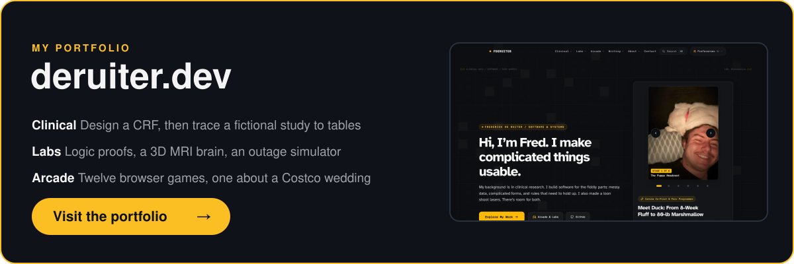

<a href="https://deruiter.dev">
  <picture>
    <source media="(prefers-color-scheme: dark)" srcset="assets/banner-dark.svg" />
    <source media="(prefers-color-scheme: light)" srcset="assets/banner-light.svg" />
    
  </picture>
</a>

  
  
  

I work with clinical data in Minneapolis and build software for things I think should be easier. Usually that means study forms, messy data, or getting two systems to talk to each other.

My background includes research at Mayo Clinic, clinical database work at BRIGHT Research Partners, and coordinating Vikings training camp. The career path has required some explanation.

## Start here

Most of my work runs in your browser, so the quickest way to see it is to go play with it.

<a href="https://deruiter.dev">
  <picture>
    <source media="(prefers-color-scheme: dark)" srcset="assets/portfolio-dark.svg" />
    <source media="(prefers-color-scheme: light)" srcset="assets/portfolio-light.svg" />
    
  </picture>
</a>

## What I’m building

Every card opens something you can try. No sign-ups.

  <a href="https://fderuiter.github.io/cadence-clinical/demo/"><picture><source media="(prefers-color-scheme: dark)" srcset="assets/cards/cadence-dark.svg" /></picture></a>
  <a href="https://fderuiter.github.io/OxidizeMath/"><picture><source media="(prefers-color-scheme: dark)" srcset="assets/cards/oxidizemath-dark.svg" /></picture></a>

  <a href="https://fderuiter.github.io/wedding_website/demo/"><picture><source media="(prefers-color-scheme: dark)" srcset="assets/cards/wedding-dark.svg" /></picture></a>
  <a href="https://qrcraftly.com"><picture><source media="(prefers-color-scheme: dark)" srcset="assets/cards/qrcraftly-dark.svg" /></picture></a>

  <a href="https://fderuiter.github.io/imednet-toolkit/tutorials/quick_start.html"><picture><source media="(prefers-color-scheme: dark)" srcset="assets/cards/imednet-dark.svg" /></picture></a>
  <a href="https://equipose.org"><picture><source media="(prefers-color-scheme: dark)" srcset="assets/cards/equipose-dark.svg" /></picture></a>

### The longer version

<b>Cadence</b>: an operating system for clinical research

 

Most eClinical stacks are a bundle of products, and each one keeps its own copy of the study, the site, and the participant. Cadence flips that around. One clinical kernel holds the truth, and EDC, site readiness, randomization, safety, and the rest are applications built on it. The protocol is a versioned CDISC USDM model, and the PDF is just a rendering of it. Who can do what is worked out from training and delegation records, not from a role name. It runs on .NET 10 and C# 14 with a Vue front end and PostgreSQL.

**[Click around the staff demo →](https://fderuiter.github.io/cadence-clinical/demo/)** · [Participant portal](https://fderuiter.github.io/cadence-clinical/subject-portal/) · [Docs](https://fderuiter.github.io/cadence-clinical/) · [Ideas welcome in Discussions](https://github.com/fderuiter/cadence-clinical/discussions) · [Source](https://github.com/fderuiter/cadence-clinical)

Pre-release and not validated for real trials. The demos run on synthetic data.

<b>OxidizeMath</b>: math I find interesting, turned into code you can run

 

A Rust workspace covering MRI Bloch equations, Lorenz and Rössler attractors, lattice Boltzmann fluid flow, Schrödinger solvers, Turing patterns, epidemic models, and Glicko-2 tournaments, plus 32 runnable examples. The egui explorer compiles to WebAssembly, so it runs in a browser tab. Every module is labeled Experimental, Validated, or Certified depending on the evidence behind it, and Lean proofs and LaTeX write-ups sit next to the code.

**[Run the simulations in your browser →](https://fderuiter.github.io/OxidizeMath/)** · [Source](https://github.com/fderuiter/OxidizeMath)

<b>Wedding website</b>: what happens when The Knot feels limiting

 

I built our wedding site myself instead of handing our guest list to a wedding platform. Then it kept going. It’s now a self-hostable Next.js and PostgreSQL platform with invitation-code RSVPs for multiple events, drag-and-drop seating charts, moderated guest photo uploads, scheduled email and SMS updates, and a registry with cash funds and group gifting. It also has a few 3D scenes for fun. Deploy it with Docker, Vercel, Cloud Run, or Railway, and your guests’ data stays in your own database.

**[Tour the demo wedding →](https://fderuiter.github.io/wedding_website/demo/)** · [Docs](https://fderuiter.github.io/wedding_website/) · [Source](https://github.com/fderuiter/wedding_website)

<b>QRCraftly</b>: a QR code studio that will never run ads

 

QRCraftly makes styled QR codes for links, Wi-Fi, contacts, events, and more. You get custom patterns, logos, and mosaic images, and it checks while you edit that the code still scans. It can also scan and explain a code before you trust it, make up to 500 codes from a spreadsheet, and send a file from one screen to another device’s camera as a stream of QR codes (that last one is in beta). Everything runs in the browser, and the decoder is my own Rust compiled to WebAssembly. No ads, no tracking, no sign-up, and the [pledge](https://qrcraftly.com/free-forever) says it stays that way.

**[Make a QR code →](https://qrcraftly.com)** · [Source](https://github.com/fderuiter/QRCraftly-web)

<b>imednet-toolkit</b>: the iMednet API without the HTTP plumbing

 

An unofficial Python SDK and CLI for the iMednet EDC API. It has typed wrappers for studies, subjects, records, and queries, sync and async clients, and workflows for bulk record creation, UAT, and audit trails. It can also build data dictionaries from CSV, ODM, or REDCap. Install it with `pip install imednet`, or try the tutorials in your browser, where the Python runs on Pyodide against simulated data.

**[Run the live tutorial →](https://fderuiter.github.io/imednet-toolkit/tutorials/quick_start.html)** · [Docs](https://fderuiter.github.io/imednet-toolkit/) · [PyPI](https://pypi.org/project/imednet/) · [Source](https://github.com/fderuiter/imednet-toolkit)

<b>Equipose</b>: randomization schemas for clinical trials

 

Equipose designs, simulates, and exports stratified block randomization for RTSM and IRT setups. It handles custom ratios like 2:1 or 3:1:1, variable block sizes, and caps per stratum. It exports matching R, Python, SAS, and Stata scripts that reproduce the same allocation from the same seed. It runs entirely in your browser, so your trial design never leaves your machine.

**[Design a schema →](https://equipose.org)** · [Source](https://github.com/fderuiter/equipose-randomization)

**[Browse everything else, including the Lean, Flipper Zero, and clinical standards experiments →](PROJECTS.md)**

## Tools I reach for

  <picture>
    <source media="(prefers-color-scheme: dark)" srcset="https://skillicons.dev/icons?i=py,ts,cs,dotnet,rust,react,nextjs,vue,angular,tailwind,postgres,docker&theme=dark" />
    
  </picture>

I care about usable interfaces, clear rules, and tests that catch something. If a result only exists in a simulation, I want that written next to the result.

## A bit more me

I created [Laser Loon](https://github.com/fderuiter/Laser_Loon) for Minnesota’s flag redesign and put the artwork in the public domain. The lasers were my contribution to the discussion.

Outside of that: ski patrol, Magic: The Gathering, Costco, and **Ducky**, my golden retriever and least productive collaborator. There’s a game about our Costco wedding on the portfolio. That probably explains enough.

<picture>
  <source media="(prefers-color-scheme: dark)" srcset="https://raw.githubusercontent.com/fderuiter/fderuiter/output/github-snake-dark.svg" />
  
</picture>
