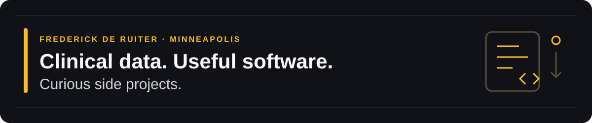

<a href="https://deruiter.dev">
  <picture>
    <source media="(prefers-color-scheme: dark)" srcset="assets/profile-banner-dark.svg" />
    <source media="(prefers-color-scheme: light)" srcset="assets/profile-banner-light.svg" />
    
  </picture>
</a>

# Howdy, I’m Fred de Ruiter.

I work with clinical data in Minneapolis and build software for things I think should be easier. Usually that means study forms, messy data, or getting two systems to talk to each other.

My background includes research at Mayo Clinic, clinical database work at BRIGHT Research Partners, and coordinating Vikings training camp. The career path has required some explanation.

**[Portfolio](https://deruiter.dev)** · [LinkedIn](https://www.linkedin.com/in/frederick-de-ruiter-88012467/) · [Say hello](https://deruiter.dev/contact)

## What I’m building

### [Cadence](https://github.com/fderuiter/cadence-clinical)

My biggest project: an operating system for clinical research. Most eClinical stacks are a bundle of products that each keep their own copy of the study, the site, and the participant. Cadence flips that around. One clinical kernel holds the truth, and EDC, site readiness, randomization, and the rest are applications on top of it. The protocol is a versioned model and the PDF is just a rendering. Built in .NET 10 and Vue.

**[Click around the staff demo →](https://fderuiter.github.io/cadence-clinical/demo/)** · [Participant portal](https://fderuiter.github.io/cadence-clinical/subject-portal/) · [Docs](https://fderuiter.github.io/cadence-clinical/) · [Ideas welcome in Discussions](https://github.com/fderuiter/cadence-clinical/discussions)

Pre-release and not validated for real trials. The demos run on synthetic data.

### [OxidizeMath](https://github.com/fderuiter/OxidizeMath)

A Rust playground where math I find interesting becomes code you can run: Bloch equations for MRI, Lorenz attractors, fluid flow, Schrödinger solvers, Turing patterns, epidemic models, and Glicko-2 tournaments. Each module is labeled Experimental, Validated, or Certified based on the evidence behind it, with Lean proofs and LaTeX write-ups alongside the code.

**[Run the simulations in your browser →](https://fderuiter.github.io/OxidizeMath/)** · [Source](https://github.com/fderuiter/OxidizeMath)

### [Wedding website](https://github.com/fderuiter/wedding_website)

The Knot felt limiting, so I built our wedding site myself. Then it kept going. It’s now a self-hostable Next.js and PostgreSQL platform with invitation-code RSVPs, drag-and-drop seating charts, guest photo uploads, a registry with group gifting, and a few 3D scenes for fun. Your guests’ data stays in your own database.

**[Tour the demo wedding →](https://fderuiter.github.io/wedding_website/demo/)** · [Docs](https://fderuiter.github.io/wedding_website/)

### More I’m proud of

| Project | What it does |
| --- | --- |
| [imednet-toolkit](https://github.com/fderuiter/imednet-toolkit) | Unofficial Python SDK and CLI for the iMednet clinical trials API. |
| [QRCraftly](https://qrcraftly.com) | Create, style, and scan QR codes in your browser. Screen-to-camera file transfer is in beta. |
| [Equipose](https://equipose.org) | Design, simulate, and export stratified block randomization schemes. |
| [deruiter.dev](https://deruiter.dev) | Clinical demos with fictional studies, interactive labs, and [games](https://deruiter.dev/arcade). |

**[Browse everything, including the Lean and Flipper Zero experiments →](PROJECTS.md)**

I mostly work in **Python, TypeScript, C#, and Rust**. I care about usable interfaces, clear rules, and tests that catch something. If a result only exists in a simulation, I want that written next to the result.

## A bit more me

I created [Laser Loon](https://github.com/fderuiter/Laser_Loon) for Minnesota’s flag redesign and put the artwork in the public domain. The lasers were my contribution to the discussion.

Outside of that: ski patrol, Magic: The Gathering, Costco, and **Ducky**, my golden retriever and least productive collaborator. There’s a game about our Costco wedding on the portfolio. That probably explains enough.
